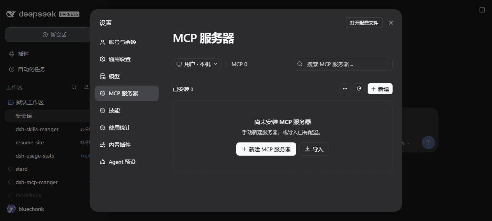
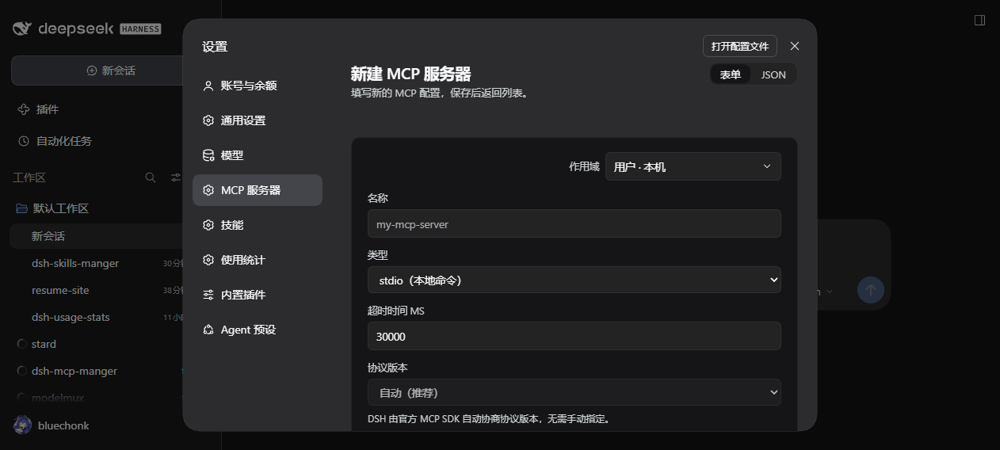

# dsh-mcp-manager

[中文](README.md) | English

A DeepSeek Harness plugin: an **"MCP Servers"** section right below **Models** in Settings — manage MCP servers and mount them at runtime, no host restart.

## Features

- Scopes: user-local and every workspace, each with its own server list
- Create/edit: a form and a JSON editor; JSON accepts `{"server-name": {...}}` and `{"mcpServers": {"server-name": {...}}}` directly
- Import an existing MCP configuration in one paste
- Enable/disable, reconnect, delete: disabling disconnects the server and unregisters all of its tools
- Live status: connected (with tool count) / connecting / failed / offline / disabled / not connected
- Host-provided MCP servers are listed read-only, grouped by feature area; a server that fails to start shows "MCP process failed to start."
- Simplified Chinese and English; light and dark themes follow the DSH theme

## Screenshots





## Install

Paste the repository URL into the DSH **Plugins** page ("+ Add plugin"), or run one of:

```sh
# CLI (forwarded to pnpm in the profile directory)
dsh plugin --profile desktop add "https://github.com/bluechonk/dsh-mcp-manager"

# Agent tool
plugin_manager install_bundle --target "https://github.com/bluechonk/dsh-mcp-manager"
```

The host writes the package into the profile's `dependencies` (as `github:bluechonk/dsh-mcp-manager`)
and adds it to `dsh.profile.bundles`; the section then appears right below **Models** in Settings.

This repository also ships a **plugin market index** (`market-index.json`). Once the market bundle is
enabled, paste the raw index URL into the index source box on the Plugins page and the plugin shows up
under Discover:

```
https://raw.githubusercontent.com/bluechonk/dsh-mcp-manager/main/market-index.json
```

### Local development

Link a checkout into the profile's `node_modules`; the host loads the link target, so edits take effect
after a page refresh:

```sh
dsh plugin --profile desktop add /path/to/dsh-mcp-manager
```

### For AI agents

1. Read this file in full (especially the known limitations).
2. Install with `plugin_manager` → `install_bundle`, passing the absolute package directory as the target.
3. Read the result: `application` must be `applied`; on `failed`, fix the cause in `error.diagnostic` and retry the same package instead of creating a copy.
4. Confirm with `cordis_inspect_query` (Slots.listSubTree, root `settings.section`) that `dsh-mcp-manager` is listed.
5. Verify the connection: after creating a server, `cordis_inspect_query` (Tool.listTools) should list `mcp__<serverName>__<tool>`.

## Where the configuration lives

```
User · Local   <DSH_HOME>/mcp-manager/servers.json
Workspace      <workspace directory>/.dsh/mcp-manager/servers.json
```

## How it works

- The connection layer is the official `@deepseek-ai/dsh-mcp-client`; the MCP protocol is not reimplemented here.
- Servers mount at runtime through `ctx.plugin(mcpClientApply, config)`; tools register as `mcp__<serverName>__<tool>` on the global tool registry.
- The host half exposes same-origin routes under `/dsh-mcp-manager/*`; the client half registers `settings.section` (order 10.5, right below Models).
- All visuals use `--dsw-alias-*` tokens — no hardcoded colors.

Details: [docs/设计与验证.md](docs/设计与验证.md) (Chinese).

## Known limitations

- The DSH tool registry is process-wide: a scope only decides where the list is stored, it cannot restrict tools to one workspace.
- A server name used in two scopes resolves to the first scope in order (user-local wins); the other one is reported as a connection failure.
- The protocol version is negotiated automatically by the official SDK, so the field is fixed to "Automatic (recommended)".
- OAuth 2.0 authorization is not supported (static headers only).

## Development

```sh
npm test        # node --test: schema / scopes / client
npm run check   # syntax check
```

The client half is a single self-contained file; the test materializes the `__ModuleLoader__` factory with a minimal React stub and exercises the `__pure` surface.

## License

MIT
