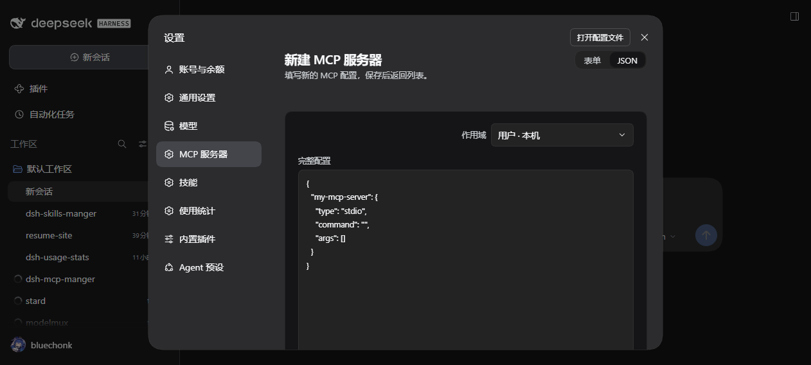
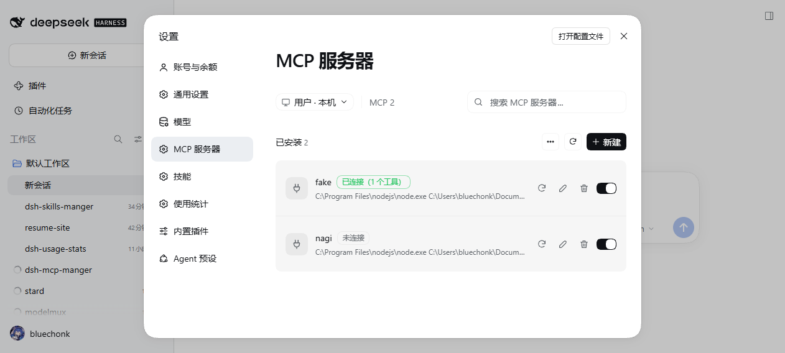
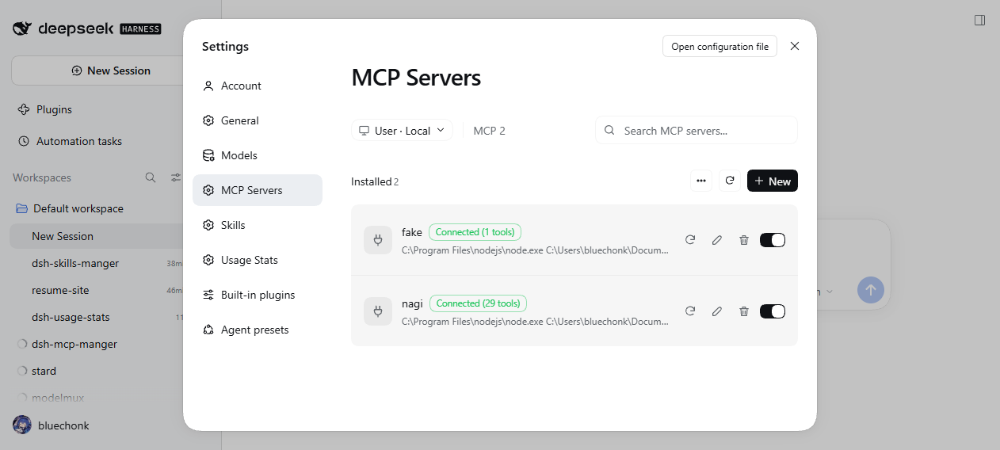

# dsh-mcp-manager 设计与验证

## 一、目标与边界

在 DeepSeek Harness 设置页「模型」正下方新增「MCP 服务器」分区，交互与 ZCode 的 MCP 管理页保持一致：
作用域切换、服务器计数、搜索、已安装分组、宿主提供的只读分组、新建/编辑页（表单与 JSON 双模式）、导入页。

| 做 | 不做 |
|---|---|
| 运行期挂载/卸载 MCP 服务器，工具即时可用 | 自研 MCP 协议实现（复用官方 `@deepseek-ai/dsh-mcp-client`） |
| 用户作用域与各工作区作用域各自维护清单 | 改动宿主 profile 补丁、HMR 配置等任何宿主状态 |
| 中英文、深浅色跟随 DSH | 自定义主题色板（只用 `--dsw-alias-*` 令牌） |

## 二、现成方案的取舍

检索范围：GitHub（`dsh-mcp-manage`）、npm（`dsh-mcp-manager`、`dsh-mcp-setting`）、DSH 官方包。

| 方案 | 借鉴点 | 未采用原因 |
|---|---|---|
| 官方 `@deepseek-ai/dsh-mcp-client` | 直接作为运行期连接层 | — |
| `dsh-mcp-manager`（npm，MIT） | 运行期挂载 `ctx.plugin(mcpClientApply, config)`、状态机（连接中/已连接/失败/离线/停用）、指数退避重试、HTTP 可达性探测、清单文件读写 | 其 UI 是「卡片 + 状态徽标」的另一套设计，与目标截图不符；清单路径 `$DSH_HOME/mcp-servers.json` 与本插件错开，避免同机并存时抢同一个文件 |
| `dsh-mcp-manage`（GitHub） | 设置页分区的整体思路 | UI 与目标截图不符 |
| `dsh-skills-manager` / `dsh-usage-stats`（本工作区） | Host/Client 分半、同源 HTTP 路由、文件存储、`--dsw-alias-*` 主题令牌、`ctx.locale` 国际化、`settings.section` 插槽注册 | — |

许可证：参考实现均为 MIT；本插件未逐行拷贝其代码，协议层直接调用官方包。

## 三、宿主机制（探查结论）

| 事实 | 来源 | 影响 |
|---|---|---|
| `settings.section` 是有序列表插槽，`order` 升序 | `Slots.listSubTree` | 插件取 `order: 10.5`，正好落在「模型」(10) 与「技能」(11) 之间 |
| 分区注册项声明 `locale` 命名空间后，宿主注入 `t` prop | `settings.section` 目录说明 | 切语言自动重渲染，无需自行订阅语言状态 |
| 主题令牌共 16 个，浅深色各一套 | `Theme.listTokens` | 全部用 `--dsw-alias-*`，深浅色自动跟随 |
| 宿主提供 `ctx.webServer.register({kind, path, handler})` | `Service.listService` | Host 半挂同源路由 |
| `ctx.tools.schemas()` 可读已注册工具 | `Service.listService` | 按 `mcp__<serverName>__` 前缀统计工具数 |
| `ctx.loader.entries()` 列出组合里的行 | `cordis-plugin-loader` 源码 | 识别宿主提供的 MCP 行（`name === '@deepseek-ai/dsh-mcp-client'`）并只读展示 |
| `ctx.plugin(fn, config)` 在运行期挂载插件并返回可 await 的 fiber | `cordis/src/registry.ts` | 连接层无需重启宿主 |
| 工具注册表是进程级的 | `dsh-mcp-client` README | 作用域只决定「清单存哪」，连接是全局的；同名以作用域顺序靠前者为准 |

### 关键坑：链接目录下的包名解析

插件从本地目录安装时，pnpm 以链接方式落到 profile 的 `node_modules`，真实路径在工作区（宿主目录树之外）。
此时普通 `import '@deepseek-ai/dsh-mcp-client'` 找不到运行期解析表里的映射，报 `ERR_MODULE_NOT_FOUND`。
解决办法：交给宿主 Loader 解析——`ctx.loader.import(name)` 的解析基址在宿主目录树内，能命中映射；
失败时再退回普通 `import`。见 `lib/index.js` 的 `resolveMcpClient()`。

## 四、数据模型

清单按作用域分文件存放，互不干扰：

```
用户·本机   <DSH_HOME>/mcp-manager/servers.json
工作区      <工作区目录>/.dsh/mcp-manager/servers.json
```

```jsonc
{
  "version": 1,
  "servers": [
    {
      "serverName": "my-server",      // [A-Za-z0-9_-]{1,32}，工具名前缀
      "transport": "stdio",           // stdio | streamable-http
      "command": "npx",               // stdio
      "args": ["-y", "@modelcontextprotocol/server-memory"],
      "env": {},
      "url": "",                      // streamable-http
      "headers": {},
      "toolCallTimeoutMs": 30000,
      "enabled": true
    }
  ]
}
```

写入用「临时文件 + rename」保证原子性；文件缺失或损坏时回落到空清单，不让界面崩。

## 五、HTTP 接口

前缀 `/dsh-mcp-manager`，只接受本机同源请求（同源 + 回环 + `Sec-Fetch-Site` 三重校验）。

| 方法 | 路径 | 作用 |
|---|---|---|
| GET | `/state?scope=<id>` | 作用域列表、当前作用域的服务器与状态、宿主提供的服务器、计数 |
| POST | `/servers` | 新建（校验名称、类型、必填字段；重名拒绝） |
| POST | `/servers/update` | 改名以外的字段更新（`serverName` 不可变） |
| POST | `/servers/toggle` | 启停：停用即断开并注销工具 |
| POST | `/servers/delete` | 删除并断开 |
| POST | `/servers/reconnect` | 断开后重连 |
| POST | `/import` | 导入既有配置，兼容 `{"mcpServers": {...}}` 与扁平映射两种形状 |

错误统一返回 `{ ok: false, error, code }`，`code` 供客户端按当前语言取文案。

## 六、运行期连接

1. 启动时按作用域顺序读取清单，已启用的服务器逐个挂载。
2. 挂载方式：`ctx.plugin(mcpClientApply, toMcpClientConfig(entry))`；配置字段显式给全，不依赖 Schema 补默认值。
3. 首次连接失败：记录错误、按 3 秒起步的指数退避自动重试（上限 60 秒），界面显示「连接失败」。
4. 停用/删除：`fiber.dispose()`，工具随之注销。
5. 状态取值：
   - `已连接`——工具数大于 0（`streamable-http` 另做一次 2.5 秒 HTTP 探测，探不通降级为「离线」）
   - `连接中`——fiber 在、工具还没到
   - `连接失败`——首次连接失败或超过 30 秒仍未建立
   - `离线`——已连接但端点不可达
   - `已停用`——被开关关闭
   - `未连接`——没有活动 fiber

## 七、界面

- 列表页：标题「MCP 服务器」、作用域胶囊 + 分隔线 + `MCP N` 计数、搜索框、「已安装 N」分组（更多/刷新/新建）、空态虚线卡、宿主提供的只读分组。
- 新建/编辑页：标题 + 副标题、右上「表单 | JSON」分段控件、作用域选择器、表单字段（名称/类型/超时时间/协议版本/命令/参数/环境变量，或 地址/请求头）、右下「保存/取消」。
- 导入页：作用域选择器 + JSON 文本框 + 「导入/取消」。
- 协议版本固定为「自动（推荐）」并附说明：DSH 由官方 SDK 自动协商，无从手动指定。
- 主题：只使用 `--dsw-alias-*` 令牌；语言：内置 zh/en 字典，命名空间 `dsh-mcp-manager`。






## 八、验证记录

| 项 | 方法 | 结果 |
|---|---|---|
| 语法检查 | `node --check`（4 个源文件） | 通过 |
| 单元测试 | `node --test`（schema/scopes，13 例） | 通过 |
| 安装 | `plugin_manager install_bundle`（desktop profile） | `application: applied`，无告警 |
| 客户端注册 | `cordis_inspect_query Slots.listSubTree settings.section` | `dsh-mcp-manager` order 10.5，位于「模型」与「技能」之间 |
| 宿主路由 | `GET /dsh-mcp-manager/state` | 返回作用域（用户·本机 + default-workspace）与空清单 |
| 端到端连接 | 自建最小 MCP stdio 服务（仅测试夹具），经接口创建 | 状态 `已连接`，工具数 1 |
| 工具可见性 | `cordis_inspect_query Tool.listTools` | 出现 `mcp__fake__echo` |
| 持久化 | 重装插件（remove + install） | 清单保留，服务器自动重连 |
| 深浅色 | 切换 DSH 主题为浅色 | 页面自动跟随，无硬编码颜色 |
| 中英文 | 切换 DSH 语言为 English | 导航、分区标题、按钮、状态徽标全部切换 |
| 状态恢复 | 验证后把主题与语言改回「跟随系统 / 中文」 | 已恢复 |

已知限制：DSH 工具注册表是进程级的，作用域只决定清单存放位置，不能把工具限定在某个工作区；
同名服务器以作用域顺序靠前者为准，另一条会被连接失败标记。
